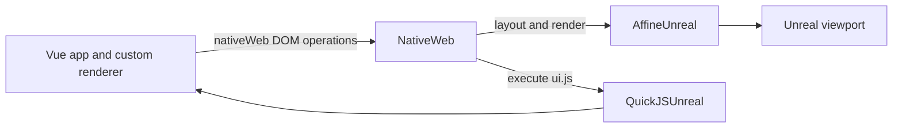

<div align="center">
  <!-- Add a project banner here when one is available. -->
  <h1>NativeWeb Vue App Example</h1>
  <p>A small Unreal Engine project demonstrating a Vue custom renderer through NativeWeb.</p>

  <p>
    <a href="https://www.unrealengine.com/"></a>
    <a href="LICENSE"></a>
    
    
    
  </p>

  <p>
    <a href="https://github.com/ArtemIyX/NativeWebUnreal"></a>
    <a href="https://github.com/ArtemIyX/AffineUnreal"></a>
    <a href="https://github.com/ArtemIyX/QuickJSUnreal"></a>
    
    
  </p>
</div>

---

## Overview

This repository is a minimal Unreal Engine example project for rendering a local Vue application with [NativeWeb](https://github.com/ArtemIyX/NativeWebUnreal). It contains an otherwise empty map and a starter Blueprint, plus a small counter interface built with Vue's custom renderer.

The sample demonstrates the integration path from Vue render operations to NativeWeb's native UI bridge, with rendering provided by [AffineUnreal](https://github.com/ArtemIyX/AffineUnreal) and JavaScript execution provided by [QuickJSUnreal](https://github.com/ArtemIyX/QuickJSUnreal).

The project has been confirmed to work with both **DirectX 11 and DirectX 12**.

## What the example includes

- A simple Unreal map and starter Blueprint to host the example UI.
- A Vue 3 counter app with increment and reset actions.
- A custom Vue renderer that maps Vue nodes and updates to NativeWeb operations.
- Packaged UI assets: `ui.js`, `ui.css`, and local font files.
- Asset-backed app authoring with imported Unreal packages and soft references.
- A generated `#app` mount root supplied by NativeWeb; the project does not include an `index.html` file.
- The Unreal-to-JavaScript integration needed to display and interact with the sample.

The application sources are maintained separately in [NativeWebVueAppExample](https://github.com/ArtemIyX/NativeWebVueAppExample). The built JavaScript and CSS used by this Unreal project are located in `Content/NativeWeb/Vue/`.

## How it fits together



NativeWeb supplies the local app shell and the JavaScript bridge. The Vue renderer creates and updates UI elements through that bridge, rather than mounting into a browser DOM. Unreal displays the result through the NativeWeb/AffineUnreal rendering integration.

## Project layout

```text
Content/
|-- Blueprints/
|   `-- BP_Starter.uasset
|-- Maps/
|   `-- MAP_Demo.umap
`-- NativeWeb/
    `-- Vue/
        |-- ui.css
        |-- ui.js
        `-- fonts/
Plugins/
|-- AffineUnreal/       # Git submodule
|-- NativeWeb/          # Git submodule
`-- QuickJSUnreal/      # Git submodule
```

## Plugin submodules

The plugins are included as Git submodules. Their repositories and roles in this example are:

| Submodule | Repository | Role in this project |
| --- | --- | --- |
| `Plugins/NativeWeb` | [NativeWebUnreal](https://github.com/ArtemIyX/NativeWebUnreal) | Creates the local UI view, supplies the generated app shell, and bridges JavaScript UI operations to Unreal. |
| `Plugins/AffineUnreal` | [AffineUnreal](https://github.com/ArtemIyX/AffineUnreal) | Provides the UI rendering integration used by NativeWeb. |
| `Plugins/QuickJSUnreal` | [QuickJSUnreal](https://github.com/ArtemIyX/QuickJSUnreal) | Runs the bundled JavaScript app inside Unreal. |

Initialize the submodules when cloning:

```bash
git clone --recurse-submodules https://github.com/ArtemIyX/VueExample.git
```

If you already cloned the project without its submodules:

```bash
git submodule update --init --recursive
```

## Requirements

- Unreal Engine **5.7**.
- Windows 64-bit development environment.
- The three plugin submodules initialized and available to UnrealBuildTool.
- DirectX 11 or DirectX 12. The project configuration defaults to DirectX 12; DirectX 11 has also been verified.

## Open the project

1. Clone the repository with `--recurse-submodules`, or initialize submodules as shown above.
2. Open `VueExample.uproject` with Unreal Engine 5.7.
3. Allow Unreal to build the project and plugins if prompted.
4. Open `Content/Maps/MAP_Demo` and run the example.

The bundled UI files are in `Content/NativeWeb/Vue/`. To change the Vue application itself, edit the source project linked above, build its output, and update the corresponding packaged files here.

## NativeWeb asset-backed example

The project also includes a cookable NativeWeb app fixture. The native editor
commandlet creates five deterministic assets under
`/Game/NativeWeb/AssetExample` and reports every package save to
`Saved/NativeWeb/AssetExample/generation-report.txt`:

```powershell
$engine = 'C:/Users/xeuse/Epic Games/UE_5.7/Engine'
& "$engine/Binaries/Win64/UnrealEditor-Cmd.exe" (Resolve-Path './VueExample.uproject').Path `
  -run=NativeWebBuildAssetExample -unattended -nop4
```

To launch the fixture in the engine Entry map, use this URL in Unreal's
`open` command:

```text
/Engine/Maps/Entry?game=/Script/VueExample.NativeWebAssetExampleGameMode
```

Add `-NativeWebAssetExampleSmoke` to run the handoff check. It exits with status
0 only after JavaScript startup succeeds and a rendered texture reaches the GPU
viewport, and with status 1 on launch failure or timeout.

`Config/DefaultGame.ini` registers `/Game/NativeWeb/AssetExample` as an
always-cooked `NativeWebApp` primary asset directory. App packages own typed
soft references to their selected source and font packages, so normal cook
reachability includes the selected dependencies when no exclusion rule
applies. For dependencies managed separately from the apps, use an explicit
`PrimaryAssetLabel` with `AlwaysCook` or a project-level directory cook rule.
The usual Vue loose-file staging rule remains enabled for ordinary runs. For a
source-free staging check, build and cook with
`-CustomConfig=NativeWebAssetExample`, which clears that staging rule for that
configuration only. A local package command is:

```powershell
$engine = 'C:/Users/xeuse/Epic Games/UE_5.7/Engine'
$project = (Resolve-Path './VueExample.uproject').Path
& "$engine/Build/BatchFiles/RunUAT.bat" BuildCookRun "-project=$project" -noP4 -unattended `
  -platform=Win64 -clientconfig=Development -build -cook -stage -pak -iostore -package `
  '-ubtargs=-CustomConfig=NativeWebAssetExample' '-map=/Engine/Maps/Entry' `
  '-archivedirectory=.agent/orchestration/nativeweb-asset-backed-apps/artifacts/package'
```

## Scope and limitations

- This is a local UI example, not a web browser. It does not load arbitrary websites or provide browser navigation.
- The app is packaged as JavaScript and CSS; NativeWeb supplies its mount element, so an HTML file is not required for this workflow.
- JavaScript runs in the embedded QuickJS runtime and communicates with Unreal through NativeWeb's available bridge. Browser-only APIs should not be assumed to exist.
- The Vue source project and this Unreal host project are separate repositories; this repository contains the packaged UI assets used by the sample.

## License

This project is licensed under the [MIT License](LICENSE). Third-party plugins and assets may have their own terms; check their repositories for details.
